<!-- ═══════════════════════════════════════════════════════════════════
     Sh² · Shpëtim Shabanaj · github.com/Shpetim10
     Every fact here mirrors shpetimshabanaj.com (src/content/*).
     ═══════════════════════════════════════════════════════════════════ -->

<a href="https://shpetimshabanaj.com">
  
</a>

<div align="center">

<a href="https://shpetimshabanaj.com">
  
</a>

<br/>

<a href="https://shpetimshabanaj.com"></a>
<a href="https://www.linkedin.com/in/shpetimshabanaj"></a>
<a href="mailto:contact@shpetimshabanaj.com"></a>
<br/>


</div>


## 👋 Hi, I'm Shpëtim

> *Excellence is not an occasional goal for me; it is the standard I apply to every line of code.*

I'm a **software engineer from Albania 🇦🇱** who believes **great AI starts with great software engineering**, so I unite the two: rigorous architecture, testing and scalability, combined with systems that learn and adapt. I graduated **first in Software Engineering at Epoka University with a perfect 4.0 GPA**, and the Prime Minister of Albania awarded me a **Gold Medal** for high school excellence. My ambition is to build technology that delivers real impact.

- 💼 **Junior Technical Consultant** at **Joint Services** — automation with n8n and LLMs *(since Oct 2026)*
- 🚀 **Co-founder & full-stack engineer** of [**HERISAGA**](https://herisaga.com) — history as playable stories
- 🤖 Studying the **Machine Learning Specialization** at **Holberton School Albania** on an AADF & AKPA scholarship
- 🎓 **B.Sc. Software Engineering**, Epoka University — 🥇 Rank #1 · 4.0/4.0 · High Honors · 100% scholarship
- 🧑‍🏫 Mentored students in **Object-Oriented Programming** and **Data Structures** (2025–2026)
- 🤝 **Open to freelance** projects — [let's talk](mailto:contact@shpetimshabanaj.com)

<details>
<summary><b>☕ The same thing, compiled</b></summary>

```java
public record Engineer(String name, String role, String location, List<String> focus) {

    public static Engineer shpetim() {
        return new Engineer(
            "Shpëtim Shabanaj",
            "Software Engineer · Junior Technical Consultant @ Joint Services",
            "Tiranë, Albania 🇦🇱",
            List.of("Enterprise Java & Spring", "Full-stack web & mobile", "Machine learning & AI systems")
        );
    }

    public Map<String, String> education() {
        return Map.of(
            "Epoka University",         "B.Sc. Software Engineering · Rank #1 · GPA 4.0/4.0 (2023–2026)",
            "Holberton School Albania", "Machine Learning Specialization · in progress (2026–)",
            "Gjimnazi Babë Dudë Karbunara", "High school · 9.94/10 · Prime Minister's Gold Medal"
        );
    }

    public boolean openToFreelance() { return true; }
}
```

</details>


## 🏆 Awards & Honors

<table>
  <tr>
    <td align="center" width="96"><h1>🥇</h1></td>
    <td>
      <b>First-Ranked Software Engineering Graduate</b> · <i>Epoka University · 2026</i><br/>
      Highest rank in the B.Sc. Software Engineering program with a <b>perfect 4.0 GPA</b> and <b>High Honors</b>; received the First Rank Award and the Plaque Award.<br/>
      <a href="https://epoka.edu.al/en/MTEzMTI=/news/2026-06-29-epoka-university-celebrates-graduation-ceremony-class-2026">🔗 Graduation ceremony news</a>
    </td>
  </tr>
  <tr>
    <td align="center"><h1>🏅</h1></td>
    <td>
      <b>Gold Medal for Excellent Academic Achievement</b> · <i>Prime Minister's Office, Republic of Albania · 2023</i><br/>
      Recognized nationally for a <b>9.94/10</b> high school record at Gjimnazi Babë Dudë Karbunara, Berat.
    </td>
  </tr>
  <tr>
    <td align="center"><h1>🥉</h1></td>
    <td>
      <b>Junction Hackathon — Pyramid Backstage Challenge</b> · <i>Junction · 2026</i><br/>
      <b>Top 3 in the challenge · Top 11 overall.</b> Led a team of five to build PyramidOs, a complete event-planning system, in 48 hours.<br/>
      <a href="https://youtu.be/705brgOoMLU">▶️ Demo video</a>
    </td>
  </tr>
  <tr>
    <td align="center"><h1>🎓</h1></td>
    <td>
      <b>Full Scholarship (100% tuition)</b> · <i>Epoka University · 2023–2026</i><br/>
      Awarded for excellent high school results and kept through all three years of the degree.
    </td>
  </tr>
  <tr>
    <td align="center"><h1>🤖</h1></td>
    <td>
      <b>Machine Learning Scholarship</b> · <i>AADF & AKPA · 2026</i><br/>
      Scholarship from the Albanian-American Development Foundation and AKPA to study Machine Learning at Holberton School Albania.
    </td>
  </tr>
  <tr>
    <td align="center"><h1>🧑‍🏫</h1></td>
    <td>
      <b>OOP Mentor & Data Structures Mentor</b> · <i>Epoka University, Career Planning and Alumni Office · 2025–2026</i><br/>
      Tutored students through the university's Mentorship Program in Object-Oriented Programming and Data Structures.
    </td>
  </tr>
</table>

## 📜 Certifications

<table>
  <tr>
    <td align="center" width="25%">
      <a href="https://learn.nvidia.com/certificates?id=ZojwdLboSBeQDTMKQQ4NMg">
        
      </a><br/>
      <b>Fundamentals of Deep Learning</b><br/><sub>NVIDIA DLI · Dec 2025</sub>
    </td>
    <td align="center" width="25%">
      <a href="https://app.diplomasafe.com/en-US/certificates/db52474b67a8d1f59f733ee61bd691264aa02e198">
        
      </a><br/>
      <b>Java From Scratch</b> (EQF 5)<br/><sub>Protik · 2025 · Java, OOP, SQL, JDBC, Hibernate, Spring</sub>
    </td>
    <td align="center" width="25%">
      <a href="https://badges.n8n.io/f8902a36-44b5-4fc1-abc7-561c512f679b">
        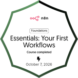
      </a><br/>
      <b>n8n101 · Essentials</b><br/><sub>n8n Academy · 2026</sub>
    </td>
    <td align="center" width="25%">
      <a href="https://badges.n8n.io/d18ecaaa-e4c5-42bb-a314-a296c4b7b546">
        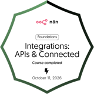
      </a><br/>
      <b>n8n102 · Integrations</b><br/><sub>n8n Academy · 2026</sub>
    </td>
  </tr>
</table>

<details>
<summary><b>🧩 Clubs & communities (Epoka University, 2024–2025)</b></summary>
<br/>

- 🟢 **Google Developer Student Club** — member
- 💻 **Programming Club** — member
- 💡 **Innovators Club** — member
- 🔌 **Electronics Club** — member

</details>


## 💼 Experience

| | Role | Company | When | What |
|:-:|---|---|---|---|
| 🟠 | **Junior Technical Consultant** | Joint Services · Tiranë | Oct 2026 → now | Automation and AI workflows with **n8n** and **LLMs** |
| ⚪ | **Junior Java Developer** | Logistiqo · Tiranë (hybrid) | Aug 2025 → Jun 2026 | Migrated enterprise logistics screens from **JSF/PrimeFaces** to **React**; built **Java EE** APIs for customer-requested features; fixed production bugs reported by customers |


## 🛠️ Tech Stack — one layer at a time

<table>
  <tr>
    <td width="170"><code>01 ─ INTERFACE</code></td>
    <td></td>
  </tr>
  <tr>
    <td><code>02 ─ API</code></td>
    <td>
    <br/>   </td>
  </tr>
  <tr>
    <td><code>03 ─ SERVICES</code></td>
    <td>
    <br/>    </td>
  </tr>
  <tr>
    <td><code>04 ─ DATA</code></td>
    <td>
    <br/>   </td>
  </tr>
  <tr>
    <td><code>05 ─ INFRASTRUCTURE</code></td>
    <td></td>
  </tr>
</table>


## 🚀 Featured Work

<table>
  <tr>
    <td width="50%" valign="top">
      <a href="https://shpetimshabanaj.com/work/herisaga-history-as-playable-stories">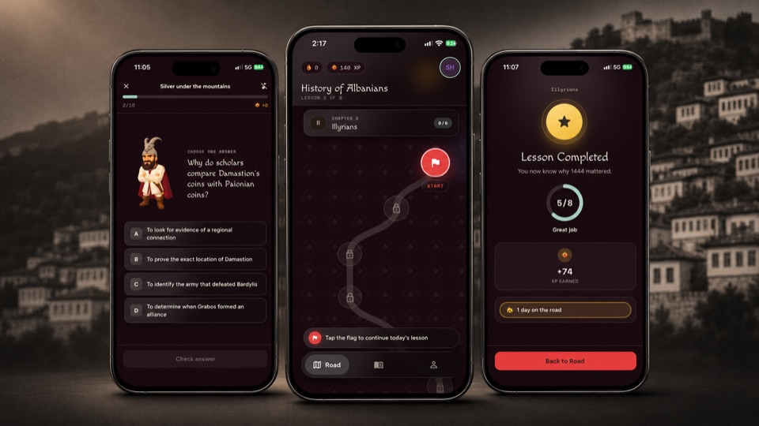</a>
      <h3>📱 HERISAGA — History as Playable Stories</h3>
      <sub><code>P/N 01</code> · Co-founder, full-stack engineer · 2026 · 🔒 private</sub>
      <p>A bilingual mobile app that turns Albanian history into playable stories, with interactive lessons, review sessions and progress tracking.</p>
      <p>✅ <b>2,438</b> mobile tests · <b>501</b> API checks · <b>4</b> question formats · 🇬🇧 🇦🇱</p>
         <br/>
      <a href="https://herisaga.com">🌐 herisaga.com</a> · <a href="https://shpetimshabanaj.com/work/herisaga-history-as-playable-stories">📖 Case study</a>
    </td>
    <td width="50%" valign="top">
      <a href="https://shpetimshabanaj.com/work/herisaga-authoring">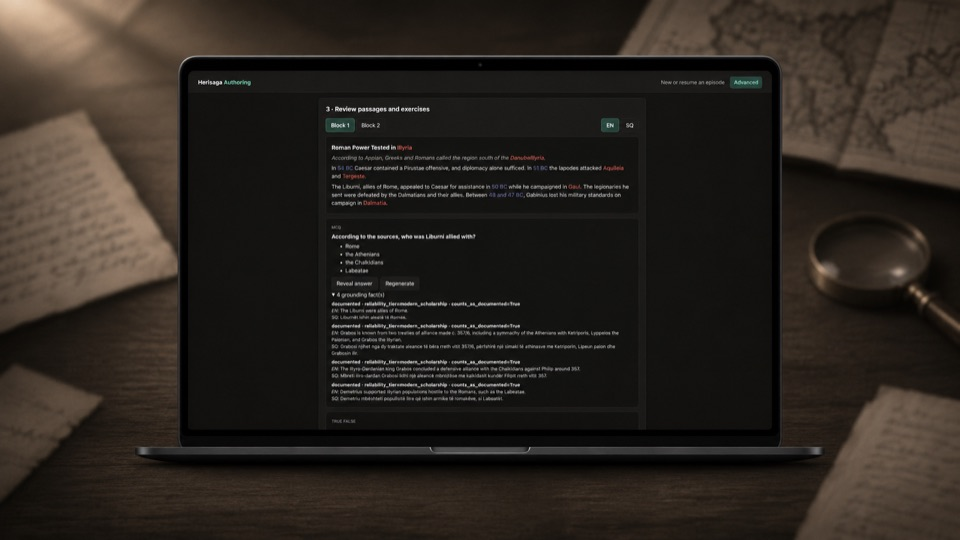</a>
      <h3>🧠 HERISAGA Authoring</h3>
      <sub><code>P/N 02</code> · Co-founder, software engineer · 2026 · 🔒 private</sub>
      <p>The AI authoring system behind HERISAGA: a source-to-facts pipeline that extracts cited facts from historical sources, so AI makes writing history faster <i>without inventing it</i>.</p>
      <p>✅ <b>11</b> tracked steps to publish · <b>0</b> drafts reach learners without human review</p>
         <br/>
      <a href="https://shpetimshabanaj.com/work/herisaga-authoring">📖 Case study</a>
    </td>
  </tr>
  <tr>
    <td width="50%" valign="top">
      <a href="https://shpetimshabanaj.com/work/ritema">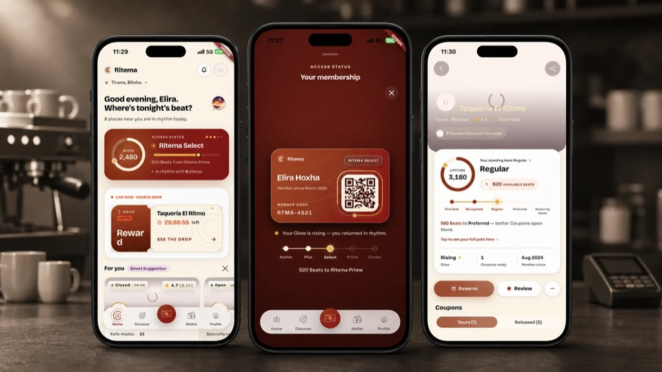</a>
      <h3>🎁 Ritema — Loyalty Program Platform</h3>
      <sub><code>P/N 03</code> · Solo full-stack engineer · Graduation project · 2026 · 🔒 private</sub>
      <p>A loyalty and rewards platform for local businesses: customers collect and redeem points, rewards and coupons by QR code in a mobile app.</p>
      <p>✅ <b>Solo</b> build, API to app · delivered <b>on time</b> with full documentation</p>
         <br/>
      <a href="https://shpetimshabanaj.com/work/ritema">📖 Case study</a>
    </td>
    <td width="50%" valign="top">
      <a href="https://shpetimshabanaj.com/work/worktrezz">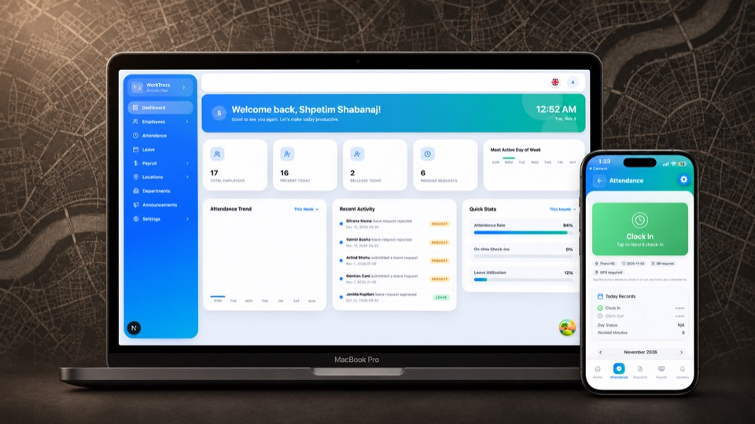</a>
      <h3>🏢 WorkTrezz — HR Management Platform</h3>
      <sub><code>P/N 04</code> · Lead software engineer · Team of 6 · 2026 · 🌍 public</sub>
      <p>Employees, departments, attendance, leave and announcements in one system: a Spring Boot API, a Next.js web app for managers and a React Native app for employees.</p>
      <p>✅ <b>3</b> connected apps · <b>live</b> updates over WebSockets · <b>GPS</b> clock-in</p>
         <br/>
      <a href="https://github.com/Shpetim10/WorkNest-Api">⚙️ API</a> · <a href="https://github.com/Shpetim10/WorkNest-Web">🖥️ Web</a> · <a href="https://github.com/Shpetim10/WorkNest-Mobile">📱 Mobile</a> · <a href="https://shpetimshabanaj.com/work/worktrezz">📖 Case study</a>
    </td>
  </tr>
  <tr>
    <td width="50%" valign="top">
      <a href="https://shpetimshabanaj.com/work/pyramidos">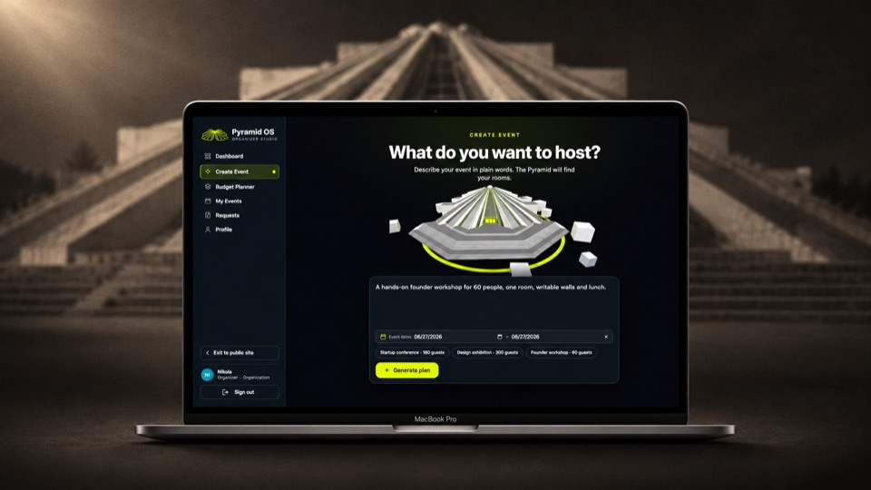</a>
      <h3>🔺 PyramidOs — Event Planning Platform</h3>
      <sub><code>P/N 06</code> · Team lead · Junction Hackathon · 48 hours · 🌍 public</sub>
      <p>Replaces scattered emails, calls and spreadsheets with one flow for requests, venue matching, proposals, equipment booking and task coordination, with AI room recommendations and a 3D venue model.</p>
      <p>🥉 <b>Top 3</b> in challenge · <b>Top 11</b> overall</p>
        <br/>
      <a href="https://github.com/Shpetim10/Piramida-OS">💻 Repo</a> · <a href="https://youtu.be/705brgOoMLU">▶️ Demo</a> · <a href="https://shpetimshabanaj.com/work/pyramidos">📖 Case study</a>
    </td>
    <td width="50%" valign="top">
      <a href="https://shpetimshabanaj.com/work/garbage-classifier">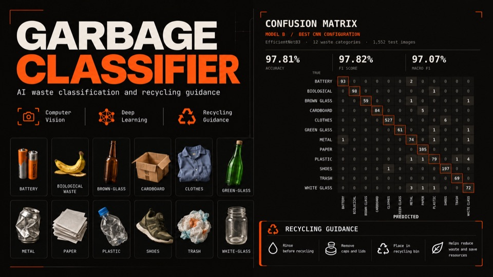</a>
      <h3>♻️ Garbage Classifier — Computer Vision</h3>
      <sub><code>P/N 05</code> · Machine learning developer · AI course · 2025 · 🌍 public</sub>
      <p>Classifies photos of waste by type. My transfer-learning model was selected as the team's final model because it achieved the highest accuracy.</p>
      <p>🎯 <b>±97%</b> test-set accuracy · <b>#1</b> of the team's candidate models</p>
        <br/>
      <a href="https://github.com/Shpetim10/Garbage-Classifier-with-Computer-Vision">💻 Repo</a> · <a href="https://shpetimshabanaj.com/work/garbage-classifier">📖 Case study</a>
    </td>
  </tr>
</table>


## 📂 Repositories

> 🌍 **Public** repos are open to browse. 🔒 **Private** repos hold startup and client-facing code — happy to walk through them on request.

<details open>
<summary><b>🌍 Public</b></summary>
<br/>

| Repository | What it is | Stack |
|---|---|---|
| [**portfolio**](https://github.com/Shpetim10/portfolio) | My professional portfolio, *Exploded View* — [shpetimshabanaj.com](https://shpetimshabanaj.com) |  |
| [**holbertonschool-machine_learning**](https://github.com/Shpetim10/holbertonschool-machine_learning) | Projects and exercises from the Holberton School ML program |  |
| [**Spotify-exploratory-data-analysis**](https://github.com/Shpetim10/Spotify-exploratory-data-analysis) | Exploratory data analysis notebook |  |
| [**Piramida-OS**](https://github.com/Shpetim10/Piramida-OS) | PyramidOs — Junction Hackathon challenge 🥉 |  |
| [**WorkNest-Api**](https://github.com/Shpetim10/WorkNest-Api) | WorkTrezz HR platform — REST API |  |
| [**WorkNest-Web**](https://github.com/Shpetim10/WorkNest-Web) | WorkTrezz — web app for admins and managers |  |
| [**WorkNest-Mobile**](https://github.com/Shpetim10/WorkNest-Mobile) | WorkTrezz — mobile app for employees |  |
| [**Garbage-Classifier-with-Computer-Vision**](https://github.com/Shpetim10/Garbage-Classifier-with-Computer-Vision) | Waste classification with transfer learning |  |
| [**Library-Management-System**](https://github.com/Shpetim10/Library-Management-System) | Library marketplace, orders and stock — I led the team |  |
| [**Operating-Systems-Final-Project**](https://github.com/Shpetim10/Operating-Systems-Final-Project) | Final project for the Operating Systems course |  |
| [**Parallel-Restaurant-Kitchen-Order-System**](https://github.com/Shpetim10/Parallel-Restaurant-Kitchen-Order-System) | Parallel restaurant kitchen order system |  |
| [**Parking-Management-System**](https://github.com/Shpetim10/Parking-Management-System) | Parking management system |  |
| [**Menu-Management-System**](https://github.com/Shpetim10/Menu-Management-System) | Website for managing restaurant menus | — |
| [**Real-Estate-Management-System**](https://github.com/Shpetim10/Real-Estate-Management-System) | Real estate management system |  |
| [**Hotel-Management-System**](https://github.com/Shpetim10/Hotel-Management-System) | Web Technologies & Design mini project |  |
| [**Hospital-Management-System**](https://github.com/Shpetim10/Hospital-Management-System) | SWE-202 Software Modeling and Design project | — |
| [**Electronics_Store**](https://github.com/Shpetim10/Electronics_Store) | Electronics store application |  |
| [**rock-paper-scissors**](https://github.com/Shpetim10/rock-paper-scissors) | Rock, paper, scissors |  |

</details>

<details open>
<summary><b>🔒 Private</b></summary>
<br/>

| Repository | What it is | Stack |
|---|---|---|
| 🔒 **herisaga-api** | HERISAGA backend — the API behind the mobile app |  |
| 🔒 **BeLoyal-API** | Ritema loyalty platform — Spring Boot API |  |
| 🔒 **Ritema-Mobile** | Ritema mobile app (v2.0 of BeLoyal-Mobile) |  |
| 🔒 **BeLoyal-Mobile** | BeLoyal mobile app, v1 |  |
| 🔒 **Coffe-Shop-Management** | Spring Boot and Thymeleaf project |  |

</details>


## 📊 GitHub Activity

<div align="center">




<picture>
  <source media="(prefers-color-scheme: dark)" srcset="https://raw.githubusercontent.com/Shpetim10/Shpetim10/output/snake-dark.svg" />
  <source media="(prefers-color-scheme: light)" srcset="https://raw.githubusercontent.com/Shpetim10/Shpetim10/output/snake-light.svg" />
  
</picture>

<sub>🐍 1,500+ contributions in the last year (Nov 2026), public and private</sub>

</div>


## 🤝 Let's build something

<div align="center">

**Have a project in mind?** I'm open to freelance work — from enterprise Java backends to full-stack web, mobile and AI systems.

<a href="mailto:contact@shpetimshabanaj.com"></a>
<a href="https://shpetimshabanaj.com"></a>
<a href="https://www.linkedin.com/in/shpetimshabanaj"></a>

<br/><br/>

<a href="https://shpetimshabanaj.com">
  <picture>
    <source media="(prefers-color-scheme: dark)" srcset="./assets/logo-dark.svg" />
    <source media="(prefers-color-scheme: light)" srcset="./assets/logo-light.svg" />
    
  </picture>
</a>

<sub>Engineered in Tiranë 🇦🇱 · <i>Excellence is the standard.</i></sub>

</div>
